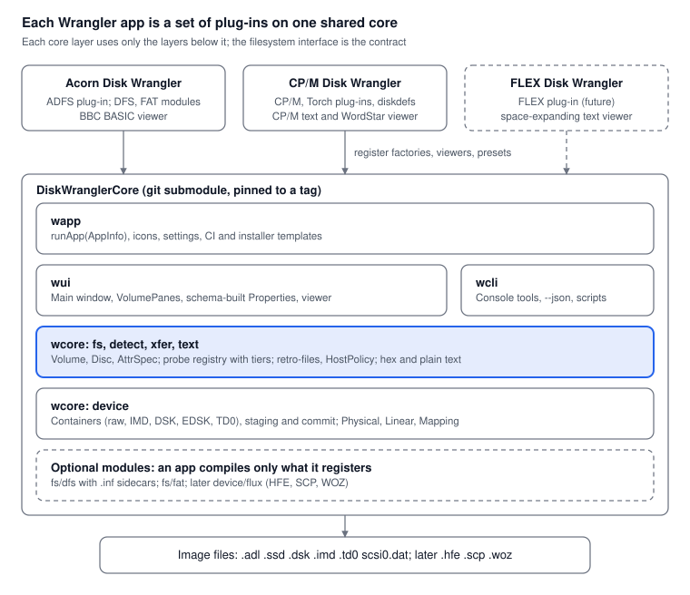

# DiskWranglerCore — modular design draft

Nov 6, 2026 · Daniel

> This copy in DiskWranglerCore (`docs/design.md`) is now the canonical design. It began as a Claude doc; later changes are made here. See the "Amendments" sections at the end for what changed in each step.

## Summary

The split works. A shared **DiskWranglerCore** library can hold the disc-image containers, a filesystem interface, detection, transfer (retro-files) and the whole Qt front end. Each Wrangler app then becomes a set of filesystem plug-ins plus branding. Checked on paper against ADFS, DFS, DOS/FAT, CP/M, Torch CP/N and FLEX, the interface holds, with five changes from what either app does today:

1. **One staging model, at sector level, in the device layer.** Today Acorn stages byte extents in `Adfs::Image` and CP/M stages sectors in `Disk::Image`. Volumes stop doing their own snapshot/restore.
2. **Volumes own their logical-to-physical mapping.** The device offers both a linear view and cylinder/head/sector-ID access, because FLEX addresses sectors by (track, sector ID) and CP/M by skewed logical sector.
3. **Paths, not sector numbers, identify files.** DFS directory letters stay an attribute, mapped per destination on copy; CP/M user areas become *namespace* levels.
4. **Attributes are described by a schema per filesystem.** Columns, the Properties dialog and retro-files groups are all built from it, replacing `dfsProps` / `dosProps` and friends.
5. **Detection returns tiers, not raw scores.** CP/M's scores and Acorn's single verdict can't be compared, and each app gets a "belongs to another app" answer for free.

The repo plan from earlier stands: a separate `DiskWranglerCore` repo, used by each app as a git submodule pinned to a tag. The core ships a `.pri` file for qmake (Qt 5) and a `CMakeLists.txt` (Qt 6). Migration is six patch series, lowest risk first; the main window moves last.

## What exists today

About a third of each app is already the same code kept in step by hand; the rest splits into a reusable skeleton with filesystem logic wired straight in. Checked against AcornDiskWrangler `00ad2ed` and CPMDiskWrangler `311b04e`.

| Group | Files | Difference |
| --- | --- | --- |
| Identical | `appsettings.h`, `buttonbar.h`, `fileopen.h`, `licences.*`, all of `ci/`, `docs/building*.md`, `docs/retro-files-format.md`, `tests/settingstest.cpp` | none |
| Same shape, forked | `dragout.*`, `viewer.*`, `viewtext.*`, `icon.*`, `main.cpp`, `newdisc.*` | 25 to 365 lines each |
| Same job, diverged | `mainwindow.*`, `mainwindow_p.h` (plus Acorn's `mainwindow_dfs.cpp`, `mainwindow_dos.cpp`) | about 2,500 lines of diff in `mainwindow.cpp` alone |
| Device layer | Acorn `Adfs::Image` (+ `SideLayout`); CP/M `Disk::Image` (raw, IMD, DSK, EDSK, TD0) | two different models |
| Filesystems | Acorn `Adfs::Image`, `Dfs::Disc`, `Dos::Volume`; CP/M `Cpm::Volume` (Torch CP/N inside it) | each with its own API |
| Detection | Acorn `detectDisk()` returns one `DiskInfo::Kind`; CP/M `Detect::detect()` returns a ranked list of scored candidates | different shapes |

Two things in the current code drive the design:

- **The device models differ.** `Adfs::Image` is a flat byte space on a `QFile`, stages byte extents and writes in place (data, then directories, then the map). The ADFS image also hosts the other filesystems: DFS sides and the DOS Plus volume (`$.DOS.DRIVE_C`, or the second half of a 640K hybrid) read through `readFileBytes`. `Disk::Image` is cylinder/head/sector with sector IDs, bad and missing sectors and per-track shape. It holds the file in memory, stages per sector and commits by temporary file + rename.
- **Files are identified differently in each filesystem.** ADFS uses (parent directory sector, name), FAT (parent cluster, name), DFS (side, letter, name), CP/M (user, name). The main window carries a separate selection struct for each (`Sel`, `DSel`, `FSel`) and a parallel set of import/extract/props/delete functions per pane. That duplication is most of the 1,500 lines.

The apps already depend on each other. `XItem` in `mainwindow_p.h` is a hand-rolled universal file record, retro-files already groups attributes by family (`acorn`, `fat`, `cpm`), Acorn refuses `AcornCpm` and `TorchCpn` discs by name, and CP/M's `interop_adw` test compiles Acorn's sources.

## Layers and repo layout

The core has four layers, each depending only on the ones below it; an app is a list of plug-ins handed to one start-up call.

| Layer | Qt modules | Holds | Comes from |
| --- | --- | --- | --- |
| `wcore/device` | Core | Containers (raw file-backed, IMD, DSK, EDSK, TD0), sector staging, commit, linear and CHS views, sub-ranges | CP/M `Disk::Image`, Acorn `SideLayout` |
| `wcore/fs` | Core | `Volume` interface, `Path`, `Entry`, attribute schema, `Disc` (one image, several mounts), transactions | new; adapters over existing code |
| `wcore/xfer`, `wcore/detect`, `wcore/text` | Core | Retro-files read/write, host export and import, `hostSafeName`, `.inf`-style sidecar hook; probe registry; hex and plain text | `dragout`, `mainwindow_p.h`, `viewtext` |
| `wui` | Widgets | Main window, volume pane, `DropTree`, button bar, viewer, Properties dialog built from the schema, New disc frame, licences, `setupTreeColumns` | `mainwindow*`, `viewer`, `newdisc`, identical files |
| `wapp` | Widgets | `dw::runApp(AppInfo)`, icon helper, settings keys, CI and installer templates | `main.cpp`, `icon`, `ci/` |

Repo layout:

```
DiskWranglerCore/                 (new repo, tagged v0.x)
  wcore/ wui/ wcli/ wapp/           sources
  fs/dfs/ fs/fat/             optional modules: diskwrangler-dfs.pri / DiskWrangler::Dfs, diskwrangler-fat.pri / DiskWrangler::Fat
  diskwranglercore.pri            qmake: SOURCES/HEADERS/RESOURCES, compiled into the app
  CMakeLists.txt              Qt 6: static library targets
  ci/                         build.sh, make-deb.sh, installer.iss.in, collect-licences.sh
  docs/retro-files-format.md  single copy
  example/                    skeleton app + in-memory test filesystem
  tests/                      core tests, run against the skeleton
AcornDiskWrangler/
  core/  -> submodule DiskWranglerCore @ tag
  src/fs/adfs, src/viewers/basic (DFS and FAT come from core/fs), src/main.cpp (AppInfo)
CPMDiskWrangler/
  core/  -> submodule DiskWranglerCore @ tag
  src/fs/cpm, src/fs/torch, src/detect, src/viewers/wordstar, src/main.cpp (AppInfo)
```

The qmake build compiles the core's sources straight into each app, so no library binary has to be shipped. Licence: GPL-3.0-or-later, the same as the apps, so any program that uses the core must make its source available. Each core file carries the same GPL header the apps use.

### Naming

Decided: every name an outsider sees is unique, searchable and tied to the Disk Wrangler family.

| Thing | Name | Why |
| --- | --- | --- |
| Repo | `DiskWranglerCore` | Sorts with `AcornDiskWrangler` / `CPMDiskWrangler`; "Wrangler" alone collides with other projects. "Disk" to match the repos. |
| C++ namespace | `dw`, nested `dw::fs`, `dw::device`, `dw::xfer` | One short, unique, lowercase top-level namespace; a single letter collides and can't be searched. Matches the apps' existing namespaces (`Adfs::`, `Cpm::`). |
| Include paths | `#include <diskwrangler/fs/volume.h>` | Both apps already have `viewer.h`, `viewtext.h`, `detect.h`, `dragout.h`; a prefixed folder rules out clashes. |
| Build targets | qmake `diskwranglercore.pri`, `diskwrangler-dfs.pri`, ...; CMake `DiskWrangler::Core`, `DiskWrangler::Dfs`, ... | Namespaced alias targets are the CMake convention and show which modules an app pulls in. |
| Macros | `DW_` prefix | Macros have no namespace. |
| Private MIME types | `application/x-diskwrangler-items` / `-source` / `-clip` | One family-wide name, so windows of different Wranglers can exchange items. `application/x-retro-files+json` is unchanged. |
| Settings | Each app keeps its own `QSettings` organisation and application name; core settings go in a group inside them | Users' existing settings survive. |
| Versions | Semantic-version tags, `v0.x` until the `Volume` interface settles | Apps pin a tag through the submodule; a major bump means an interface break. |



*DiskWranglerCore layers: 3 apps, 4 core layers, optional modules.*

Apps only add plug-ins and pick the optional modules they need (Acorn: DFS and FAT); everything from the window down to the image file is shared, and the highlighted filesystem layer is the contract a new app writes against.

## Block device layer

Build the device layer from CP/M's `Disk::Image`, not Acorn's `Adfs::Image`. It already models what FLEX and CP/M need (sector IDs, per-track shape, bad sectors), and Acorn's side order fits on top of it as a mapping. Three pieces:

- **`Container`**: the file. One per format: raw, IMD, DSK, EDSK, TD0 (read-only). It owns the staged writes, `snapshot()` / `restore()`, `commit()` and `saveAs()`. The raw container becomes file-backed (reads from the `QFile`, staged sectors overlaid) so a large `scsi0.dat` isn't loaded whole.
- **`Physical`**: cylinder / head / sector access to a container, addressed by index in ID order *or* by sector ID. For a raw file this exists only once someone supplies a `RawLayout` (geometry).
- **`Linear`**: a flat sector-or-byte space over either a raw file directly or a `Physical` plus a `Mapping`. Sub-ranges of it (`slice`) give the DOS Plus partition inside an ADFS file and each DFS side.

```cpp
namespace dw {

class Container {                       // one image file
public:
    virtual QString kindName() const = 0;
    virtual bool readOnly() const = 0;
    virtual Physical *physical() = 0;    // nullptr: raw file with no layout yet
    virtual Linear *rawLinear() = 0;     // raw files only: the bytes as stored
    Snapshot snapshot() const;           // staged writes
    void restore(const Snapshot &);
    bool dirty() const;
    bool commit(QString *err, bool backup = true);   // checked copy + atomic rename (see Saving)
    bool saveAs(const QString &path, Kind as, QString *err);
};

class Physical {                        // what Disk::Image's track/sector API becomes
public:
    int cylinders() const; int heads() const;
    const Track *track(int c, int h) const;              // shape, IDs, bad/missing flags
    bool read(int c, int h, int idx, QByteArray *out) const;
    bool write(int c, int h, int idx, const QByteArray &d, QString *err);
    int indexOfId(int c, int h, int sectorId) const;     // new: FLEX addresses by ID
};

struct Mapping {                        // logical sector n -> (c, h, idx)
    virtual bool locate(qint64 n, int *c, int *h, int *idx) const = 0;
    virtual qint64 sectors() const = 0;
    virtual int sectorSize() const = 0;
};
// Provided: SideOrderMapping (Acorn interleaved / sequential / side-first)
//           and CpmMapping (alt, outback, outout, altrev, skew, offset) in the CP/M plug-in.

class Linear {
public:
    qint64 size() const; int sectorSize() const;
    bool read(qint64 off, qint64 len, QByteArray *out, QString *err) const;  // byte ranges; RMW on sectors
    bool write(qint64 off, const QByteArray &d, QString *err);
    Linear slice(qint64 off, qint64 len) const;                             // DOS partition, DFS side
};
}
```

What changes for each app:

- **Acorn.** `Adfs::Image` loses its file handling, `m_pending`, `SideLayout` translation and `snapshot()`. It becomes the ADFS filesystem over a `Linear`. Side order is a `SideOrderMapping`, and Tools > Side order > Convert becomes a `saveAs` with a different mapping. The ADFS map's own consistency check stays in ADFS and runs as a commit validator.
- **CP/M.** Mostly a move. `Disk::Image` is split into the containers and `Physical`; `Format::locate` becomes `CpmMapping`. TeleDisk stays read-only (Save As only).
- **Both.** All writes are staged in the container. Commit is always a checked copy then an atomic rename, with an optional `.bak` (CP/M today), not Acorn's in-place write. There is no in-place mode, whatever the image size (see Saving below).

### Saving

No file is changed until the new contents have been checked as they will be stored, and the original survives any failure up to the final rename. `Container::commit` does:

1. Validate the staged state: every mount's `check()`; any error stops the save.
2. Stream a temporary file in the same folder: unchanged ranges copied from the original, staged sectors written over them (a large image is never held in memory).
3. Flush it to disc.
4. Re-open the temporary file with the same container and filesystem code and run the checks again. This checks the bytes, not just the in-memory model.
5. Optionally make the `.bak` (hard link to the original where the platform allows, else a copy).
6. Atomically replace the original.

`QSaveFile` provides steps 2, 3 and 6 on every platform; the core adds steps 1, 4 and 5.

- **Cost.** Every save rewrites the whole image: a second or two for a few hundred MB on an SSD, longer on SD cards and USB sticks. Check free space first and say plainly when there isn't room.
- **Image in use.** If an emulator has the image open, the replace can fail on Windows. That is the right outcome; report it as "in use by another program".
- **Permissions and ownership** carry over to the new file; test on each platform.
- **Damaged on open.** An image that fails its checks when opened stays read-only, as now; Save As to a new file goes through the same checks.

## Filesystem interface

A `Volume` is one filesystem on one device. It lists, reads and changes files by `Path`, and describes its own attributes so the front end never needs to know which filesystem it is showing. A `Disc` is an opened image: one container plus one or more mounted volumes.

```cpp
namespace dw {

struct Path { QStringList parts; };           // from the volume root; stable across reloads

enum class NodeKind { File, Dir, Namespace }; // Namespace: a level that isn't a directory on disc
                                              // (CP/M user area; DFS letters stay attributes)
struct Entry {
    QString name;  NodeKind kind = NodeKind::File;
    qint64 size = 0;  bool sizeExact = true;   // CP/M 2.2: record granularity
    QDateTime modified, created, accessed;      // invalid = none
    AttrValues attrs;                           // keyed by AttrSpec::key
    QString problem;                            // shown, makes the entry read-only
};

struct AttrSpec {                              // drives columns, Properties, retro-files
    QString key, label;                         // "load", "Load"
    enum Type { Bool, Hex32, Int, Choice, Text, Date } type;
    QStringList choices;  int bits = 32;        // Choice / Hex width (DFS: 18)
    bool editable = true, column = true;  QString sample;  // column width hint
    QString retroFamily, retroKey;              // "acorn", "load"
};

struct Caps {
    bool dirs, namespaces, rename, renameAcrossDirs, title, dates, settableDates;
    bool contiguousOnly;                         // DFS: free space must be one run
    int  maxEntriesPerDir = -1;                  // DFS 31/62, ADFS 47, CP/M directory size
};

struct NameRules {
    virtual bool valid(const QString &n, NodeKind, QString *why) const = 0;
    virtual QString fromHost(const QString &hostName, NodeKind) const = 0;   // sanitise
    virtual Qt::CaseSensitivity caseSensitivity() const { return Qt::CaseInsensitive; }
};

class Volume {
public:
    virtual QString fsId() const = 0;           // "adfs", "dfs", "fat", "cpm", "torch", "flex"
    virtual Caps caps() const = 0;
    virtual QVector<AttrSpec> fileAttrs() const = 0;
    virtual QVector<AttrSpec> volumeAttrs() const = 0;   // title, boot option, label, ...
    virtual const NameRules &names() const = 0;
    virtual VolumeInfo info() const = 0;        // title, total, free, largest free run, entries free

    virtual bool list(const Path &dir, QVector<Entry> *out, QString *err) const = 0;
    virtual bool read(const Path &file, QByteArray *out, QString *err) const = 0;

    // Mutations. The caller (Disc) wraps each in a Transaction: on failure the
    // container is restored and reload() called, so volumes need no rollback code.
    virtual bool write(const Path &dir, const QString &name, const QByteArray &data,
                       const AttrValues &attrs, const QDateTime &when, bool replace, QString *err) = 0;
    virtual bool mkdir(const Path &dir, const QString &name, QString *err);
    virtual bool remove(const Path &node, QString *err) = 0;           // recursive for dirs
    virtual bool rename(const Path &from, const Path &to, QString *err);
    virtual bool setAttrs(const Path &node, const AttrValues &a, QString *err) = 0;
    virtual bool setVolumeAttrs(const AttrValues &a, QString *err);

    virtual Report check() const = 0;           // also a commit validator
    virtual bool reload(QString *err) = 0;      // re-read caches after restore()

    virtual QVector<ActionSpec> actions() const { return {}; }   // fs-specific menu items
};

class Disc {                                    // replaces the per-pane state in MainWindow
public:
    Container *container();
    struct Mount { QString label; Volume *vol; bool readOnly; QString readOnlyWhy; };
    QVector<Mount> &mounts();                   // ADFS + DOS; DFS side 0 + side 2; one CP/M volume
    template<class F> bool transact(F &&f, QString *err);   // snapshot, run, restore + reload on failure
    Report validateAll() const;                 // every mount's check(); errors veto commit
    bool commit(QString *err);
};
}
```

How existing code fits: each current class gets a thin adapter (`AdfsVolume` wraps `Adfs::Image`, `DfsVolume` wraps `Dfs::Disc`, and so on). Paths resolve to the sector, cluster or (user, name) the class already takes. The filesystem code itself is not rewritten in the first pass; the adapters are thin, and real refactors (removing each class's own staging) follow once the tests pass.

Two deliberate gaps:

- **No inode or handle API.** Everything goes by path, because the main window already re-resolves (parent, name) after every change. Path lookups are cheap at these disc sizes.
- **No streaming.** Files are `QByteArray`s, as now. The largest file on any of these filesystems is a few MB.

## Detection, transfer and viewers

Detection, cross-disc copying and file viewing all become registries that plug-ins add to; the core runs them and the apps supply the knowledge.

### Detection

```cpp
struct Candidate {
    QString fsId, description;
    enum Tier { Certain, Likely, Possible, Foreign } tier;   // Foreign: "this is a CP/M disc"
    double score;                       // compared only within one factory
    QStringList evidence, notes;
    bool safeToWrite;
    std::function<bool(Disc *, QString *)> mount;          // builds mapping + volumes
};
struct FsFactory {
    virtual QString fsId() const = 0;
    virtual QVector<Candidate> probe(ProbeContext &ctx) const = 0;
    virtual QVector<NewDiscPreset> presets() const { return {}; }
    virtual QWidget *formatEditor(Disc *) const { return nullptr; }   // CP/M format dialog
};
```

The core opens the container first. For a raw file, `ProbeContext` offers the bytes as stored (`rawLinear`) and lets a factory propose a `RawLayout`. Acorn proposes layouts from its size table, CP/M from file size and diskdefs, FLEX from its System Information Record. The core then sorts by tier, then score, and takes the best:

- Two `Likely` candidates from different factories → ask the user.
- A `Foreign` candidate as the best answer → the existing "open it in the other Wrangler" message.

Each app can register a lightweight foreign recogniser for the other apps' formats without linking their filesystem code. Acorn's `AcornCpm` / `TorchCpn` refusals become this.

#### Opening an image another Wrangler owns

Decided: when the best candidate is `Foreign`, the core launches the owning Wrangler with the image and tells the user it has done so. Nothing is opened or changed in the current window.

1. Find the other app. A foreign recogniser carries the app's id (`cpmdiskwrangler`), so the core looks in, in order:
   - a path the user has set in Preferences (overrides everything);
   - the folder the current app runs from (both apps installed side by side, as the installers and `.deb` do);
   - the platform's own registration: App Paths in the Windows registry, the bundle id on macOS, the `.desktop` file on Linux, then `QStandardPaths::findExecutable`.
2. Found: `QProcess::startDetached(app, {imagePath})`, then a message: "This is a CP/M disc, so it has been opened in CP/M Disk Wrangler." with a "Don't show this again" box.
3. Not found, or the launch fails: today's message naming the app it belongs to, plus a link to that app's releases page.

The same applies to drops: a foreign image dropped onto a window opens in the other app rather than being imported as a file.

### Transfer

`XItem` becomes `dw::TransferItem`, which is a retro-files item held in memory:

```cpp
struct TransferItem {
    QString name; bool isDir; QByteArray data; QDateTime when;
    QMap<QString, QJsonObject> attrs;       // by retro-files family: "acorn", "fat", "cpm", later "flex"
    QString sourceFs;                       // "dfs", ...
    QVector<TransferItem> kids;
};
```

Each volume converts its attributes to and from families through its `AttrSpec`s (`retroFamily`, `retroKey`), plus two optional hooks for anything a key-to-key mapping can't express (DFS widening load/exec to 32 bits, ADFS deriving type and date from load/exec). The core then does all of:

- drag-out and copy,
- drops and paste between windows,
- extract to host,
- import from host.

Per-filesystem host behaviour goes in a `HostPolicy` on the factory:

- the host name for an entry,
- an optional sidecar writer and reader (Acorn `.inf`),
- content transforms offered as extract options (CP/M: trim ^Z; FLEX: expand space compression),
- a folder layout for namespaces (CP/M `userN`).

The private MIME types become `application/x-diskwrangler-items` / `-source` / `-clip`, with the app name inside the payload.

#### DFS directory letters

Decided: inside a DFS volume the letter is an attribute on a flat list (`A.BOOT` is the file's path). What the letter becomes on copy depends on the destination, through an optional `Volume::placeIncoming(TransferItem, Path targetDir) -> Path` hook. Retro-files already carries the full name (`"name": "A.BOOT"`), so the receiver always has the letter.

| Destination | `$.NAME` | `A.NAME` | Why |
| --- | --- | --- | --- |
| Host folder | `NAME` | `A.NAME` (as now; `.inf` keeps the full name) | Folders get in the way on the host |
| ADFS | `NAME` in the target directory | `NAME` in subdirectory `A` of the target, created on demand | On ADFS `A.NAME` relative to the current directory is exactly that, so `*RUN A.PROG` and `CHAIN "A.MENU"` still work |
| DFS | letter kept | letter kept | Same filesystem |
| FAT, CP/M | `NAME` | `A_NAME` or dropped, by option | No equivalent; lowest priority |

- **Default and option.** "DFS directories become ADFS directories" is on by default, a remembered setting with a "flatten" alternative, not a prompt on every copy.
- **Round trip.** The existing `letterPolicy` (single-letter ADFS directory → DFS letter) is the reverse mapping. A test copies DFS → ADFS → DFS and expects the original catalogue back.
- **Letters ADFS can't take as directory names.** From the ROMs (ADFS 2.10, DFS 2.45): DFS 2.45 accepts any printable character as a directory letter apart from `:` and `.` (filename parser at &8103). ADFS 2.10 rejects `DEL ^ @ : $ &` inside a name component (table at &8B2D), ends a component at `.`, `"` or a control character (&8525), and refuses the wildcards `*` and `#` when creating (&8B02). So `$` maps to the target directory itself, and the letters `^ @ & * # "` fall back to a flat `X_NAME` in the target directory with a warning in the import summary.
- **Whole-disc copy.** A later DFS-to-ADFS disc copy (for hard discs and BeebSCSI) uses the same mapping.

### Viewers

```cpp
struct FileViewer {
    QString id, name;                         // "basic", "BBC BASIC"
    virtual int accepts(const Entry &, const QByteArray &, const QString &fsId) const = 0;   // 0 = no
    virtual QString render(const QByteArray &, const QVariantMap &opts, QString *err) const = 0;
};
```

The core ships Hex and Plain text. Acorn registers BBC BASIC; CP/M registers CP/M text (stop at ^Z, strip bit 7) and WordStar detection. The viewer dialog offers every viewer whose `accepts` is non-zero and opens on the highest.

## UI layer and app kit

The main window becomes one generic class that shows a `Disc`: one `VolumePane` per mount, every menu action written once against `Volume`, and the filesystem-specific parts supplied by the plug-in. A new app is then about a page of code plus its filesystem.

- **`VolumePane`**: a `DropTree` whose columns come from `fileAttrs()` via `setupTreeColumns`, with a root row from `rootLabel()`. Namespace levels show as folder rows (CP/M users) or not at all if the plug-in chooses. Mounts appear as tabs (ADFS / DOS today) or as several roots in one tree (both DFS sides today): `Mount` gets a `group` field so the plug-in picks which.
- **Generic actions**: Add files, Add folder, New directory (when `caps().dirs`), Delete, Rename, Properties, Extract, View, Copy / Paste, Check, Save, Save As, Revert, Disc properties (from `volumeAttrs()`: title, boot option, label). The current per-pane copies (`dosImportFile` / `dfsImportFile` / `importPaths` and so on) collapse into one import path through `NameRules::fromHost` and the `HostPolicy`.
- **Questions during import**: "replace / skip / all" stays in core. Filesystem-specific questions (Acorn's "single-letter ADFS directory → DFS letter?", CP/M's target user) are an `ImportPrompt` hook on the volume, which returns a question the core shows.
- **Plug-in actions**: `Volume::actions()` and `FsFactory` add menu items: Acorn's Tools > Side order, CP/M's Change format and the format dialog.
- **New disc**: the core dialog lists every factory's `presets()` (name, size, container kinds) with an optional options widget from the factory.

App kit:

```cpp
int main(int argc, char **argv) {
    dw::AppInfo app;
    app.name = "Acorn Disk Wrangler";  app.id = "acorndiskwrangler";
    app.icon = ":/icons/acorndiskwrangler.svg";  app.about = tr("...");
    app.factories = { new AdfsFactory, new DfsFactory, new DosFactory,
                      new dw::ForeignRecogniser("cpm", "CP/M Disk Wrangler") };
    app.viewers = { new BasicViewer };
    app.settings = { /* app-specific keys */ };
    return dw::runApp(argc, argv, app);
}
```

`ci/` scripts take the app id from `version.cmake` / `version.pri`. `installer.iss` and the `.desktop` file become templates filled in at build time, so a new app's CI is a copy of the workflow file.

## Command line

Decided: each app also ships a console program built from the same plug-in list, so every GUI action is scriptable. A small `wcli` layer sits beside `wui`. It uses only the QtCore layers, so it needs no display and runs on servers and in CI.

- **A separate binary per app**: `acorndw`, `cpmdw` (a FLEX app would ship `flexdw`). Each is a few lines calling `dw::runCli(argc, argv, info)` with the same `AppInfo`. It is not a `--cli` mode of the GUI program, because a Windows GUI program can't write cleanly to the console it was started from. Installers and the `.deb` put it next to the GUI app.
- **One invocation, one save.** A run opens the image, applies its operations and commits once, through the same checked copy and rename as the GUI. `script` reads several operations from a file or stdin, so a large hard-disc image isn't rewritten per file.
- **Commands** (mirroring the GUI):

| Command | Does |
| --- | --- |
| `info`, `check` | Describe the image; report problems (exit code set) |
| `ls` | List a directory or the whole tree |
| `get` / `put` | Extract to host / import from host, with sidecars and transforms per `HostPolicy` |
| `rm`, `mkdir`, `mv` | Delete, make a directory, rename or move |
| `attr`, `title`, `boot` | File attributes (load/exec, locked, user...), disc title, boot option |
| `new` | Make a blank image from the same presets as File > New |
| `convert` | Change container format or side order (`saveAs`) |
| `copy` | Copy between images, with the same DFS-letter mapping as drag and drop |
| `script` | Run several operations from a file or stdin, one save at the end |

- **Made for scripts**:
  - `--json` output on every listing and report;
  - documented exit codes;
  - `--dry-run`.
  - Every question the GUI asks becomes a flag: `--replace` / `--skip`, `--letters=dirs|flatten`, `--sidecars=inf|none`, and `--fs` / `--format` to override detection.
- **Arguments**: image and path are separate (`acorndw get scsi0.dat '$.Games.Elite' out/`), never `image:path`, because the colon clashes with Windows drive letters and ADFS `:0` drive syntax. This follows mtools and cpmtools; the CP/M app may also accept cpmtools-style options where that is cheap.
- **Foreign images**: the CLI never launches the other app. It names the Wrangler that owns the image and exits with a specific code.
- **Testing**: the CLI doubles as the test harness. Tests run commands against sample images and compare the results with stored, known-good output (golden-image tests). They are easier to write than GUI tests, run in CI, and check that GUI and CLI give the same results.

When: step 4b, straight after the `Volume` and `Disc` interfaces exist and before the main window is rebuilt. That makes the CLI the first real user of the new interface and gives step 5 a regression net.

## Shared filesystems and modules

A filesystem or format moves into the core when a second app needs it, or when other filesystems live inside it. Each one is an optional module with its own `.pri` file and CMake target, so an app compiles only what it registers and the base core holds no format code.

| Module | Status | Why it is shared | Notes |
| --- | --- | --- | --- |
| `fs/dfs` | decided, step 4 | Hosts Acorn Z80 CP/M discs (DFS-fenced) and any BBC-related Wrangler | Brings the Acorn `.inf` sidecar reader and writer and the DFS new-disc presets with it; absorbs CP/M's `acornDfsCatalogue` |
| `fs/fat` | decided, step 4 | FAT12/16 is used by the Master 512, PC, Amstrad PC1512, MSX-DOS 2, Atari ST and others | Today `Dos::Volume`; mounts on a whole disc or a `Linear` slice (DOS Plus inside ADFS) |
| `device/flux` | decided, later | Decoding FM/MFM flux to sectors is the same work whatever filesystem sits on top | HFE, SCP, WOZ as container types that present a `Physical`; every Wrangler can open them once added |
| Viewer pack | possible | Some formats cross machines: Microsoft BASIC (MBASIC), WordStar, BBC BASIC (Z80 BASIC stores lines differently and needs its own decoder) | Optional viewers registered by apps that want them |
| `Charset` | possible | 8-bit machines with their own character sets (CP/M national characters, Acorn `£` at &60, teletext) | Used by name rules and the text viewer |
| Candidate ranking | possible | The CP/M approach (try layouts, score what the directory makes of each) suits FLEX and any ambiguous geometry | The framework moves; CP/M's scoring stays in the CP/M app |

Staying in their apps for now: ADFS old map (Acorn only), CP/M and Torch CP/N (the CP/M app is that tool; revisit if another app wants to open CP/M in place), and filesystem-specific date formats.

Order matters: `Dfs::Disc::attach` takes an `Adfs::Image*` and uses `Adfs::Report` and `bootOptionName` from `adfs.h`, and `Dos::Volume` attaches through an ADFS file's start sector and length. Both have to be on `Linear` (step 3) before they can move.

## Sense check

All six filesystems fit the interface. None needs a special case in the core; the difficult parts all sit in device addressing and in a few hooks, not in `Volume` itself.

| Filesystem | Device access | Paths | Attributes (schema) | Volume attributes | Awkward bits and where they land |
| --- | --- | --- | --- | --- | --- |
| ADFS (old map) | `Linear`, 256-byte sectors, via `SideOrderMapping` on floppies | real directories, 10-char names | R W L E, load, exec, derived type and date | title, boot option | Hybrid 640K: ADFS mount read-only (`Mount::readOnly`); 47 entries a directory (`maxEntriesPerDir`) |
| DFS (+ Watford 62) | `Linear::slice` per side | flat, `D.NAME` | locked, load, exec (18-bit) | title, boot option | Letter is an attribute, mapped per destination on copy (see Transfer); contiguous free space (`contiguousOnly`, `largestFree`); 31/62 files |
| DOS Plus / FAT12/16 | `Linear::slice` of an ADFS file, or the whole disc | real directories, 8.3 | R H S A, date | label | Mount depends on ADFS: its range must not move while mounted (already true); `lostClusters` goes in the `Report` |
| CP/M 2.2 / 3 / P2DOS / ZSDOS | `Physical` + `CpmMapping` (skew, side order, offset) | user areas as `Namespace`, 8.3 | R/O SYS ARC F1-F4, created / updated / accessed | label (when allowed) | Format is a guess the user may change: `formatEditor` + re-mount; size inexact on 2.2 (`sizeExact`); national characters via `NameRules` |
| Torch CP/N | `Physical`, fixed 2 x 80 x 10 x 256 | user areas, 8.3 | as CP/M | none | Today a mode inside `Cpm::Volume` (`torch*` methods): split out into its own volume, sharing CP/M's name rules and attribute specs |
| FLEX (paper only) | `Physical` addressed by (track, sector ID) through `indexOfId` | flat, 8.3 | write, delete, read and catalog protect; random-file flag; date | label, volume number | Linked 252-byte data sectors and a free chain (FLEX's own business); track 0 often a different density (per-track shape); raw `.dsk` geometry read from the SIR (raw probe) |

What FLEX shows:

1. **The device has to be addressable by sector ID.** FLEX stores links as (track, sector) using the sector numbers on the disc, starting at 1. On double-sided discs the numbering usually continues onto side 1. `Disk::Image` addresses by index in ID order, so `indexOfId` is added and the FLEX plug-in owns its own (track, sector) → (cylinder, head, ID) mapping.
2. **Raw images need probing before their geometry is known.** A FLEX `.dsk` gives its maximum track and sector in the System Information Record on track 0. The probe reads `rawLinear` first, then proposes a `RawLayout`. Acorn and CP/M already work this way implicitly.
3. **Content transforms belong to the filesystem.** FLEX text compresses runs of spaces (a TAB byte followed by a count). Extract and view need an "expand" option, as CP/M needs "trim ^Z". Both go in `HostPolicy` and the viewers, not the core.
4. **Retro-files needs a `flex` family.** It slots in as the format doc intends.

(The FLEX layout above is from memory: SIR in track 0 sector 3, directory chained from sector 5, 24-byte entries, 2-byte link + 2-byte record number per data sector. Check it against the FLEX documentation before anything is built.)

Other things the check turned up:

- **Staging and caches.** Every volume keeps decoded state (ADFS `FsMap`, DFS file list, FAT copy, CP/M directory). Moving rollback into `Disc::transact` only works if every volume implements `reload()` faithfully. CP/M has it already; the Acorn classes will need it added and tested.
- **Cross-volume validation.** ADFS currently vetoes a save through `setExtraValidator` when the DOS volume is broken. This becomes `Disc::validateAll()`, which runs every mount's `check()`.
- **Detection scores aren't comparable.** CP/M scores are open-ended doubles and Acorn returns one verdict. Tiers solve the cross-factory question, and each factory keeps its own scoring.
- **Tests use internals.** `guitest`, `sidetest` and `dragtest` call `dfsTree()`, `dosTree()`, `image()` and similar. The generic window should keep those as forwarding shims until the tests have been moved to the new API.

## Migration plan

Six patch series, each leaving both apps building and passing their tests. Behaviour changes only from step 3 on.

1. **Create DiskWranglerCore v0.1 from the identical files.** `appsettings.h`, `buttonbar.h`, `fileopen.h`, `licences.*`, `ci/`, the shared docs and `settingstest`. Add it as a submodule in both apps, delete their copies and point `.pro` / `CMakeLists.txt` at `diskwranglercore.pri` and the core targets. One series for the core, one per app.
2. **Helpers and retro-files.** `hostSafeName`, `setupTreeColumns`, `fmtBytes`, `anyCase`, `deleteKeys`, `rootLabel`, and the retro-files reader and writer from `dragout`, with `XItem` becoming `TransferItem` (`interop_adw` becomes a core test). Viewer registry with Hex and Plain; BASIC and WordStar move behind it in the apps.
3. **Device layer.** Move `Disk::Image` into core as containers, `Physical` and `Linear`; add the file-backed raw container and `indexOfId`. CP/M switches first (smallest change). Acorn's `Adfs::Image` then sits on `Linear` with `SideOrderMapping`. This is the riskiest step; Acorn's `sidetest`, `floptest`, `boottest` and `watfordtest` are its safety net.
4. **Volume interface and adapters.** `Volume`, `Disc`, `AttrSpec`, detection registry. Wrap the existing filesystem classes without rewriting them. DFS (with the .inf sidecar code) and FAT then move into core/fs as optional modules, now that they sit on Linear instead of Adfs::Image. Old and new detection run side by side, and a test asserts they agree on every test image. Then step 4b, its own series: the wcli layer and the acorndw / cpmdw console programs, with golden-image tests (see Command line).
5. **Generic main window.** CP/M first (one mount, fewer panes), then Acorn. Keep the old accessors as shims for the GUI tests. Torch is split out of `Cpm::Volume` here.
6. **Clean-up and a third app.** Remove each filesystem class's own staging. Then build a minimal FLEX app as the proof that a new Wrangler is mostly filesystem code. Flux containers (HFE, SCP, WOZ) follow as a core device module, which every app then gets without changes.

## Open questions

- [x] DFS directory letters: decided. The letter is an attribute on a flat list; each copy destination maps it (see DFS directory letters under Transfer).
- [x] Core licence: decided, GPL-3 (GPL-3.0-or-later, as the apps). Anything built on the core must publish its source.
- [x] Commit model: decided. Always a checked copy, then an atomic rename; no in-place mode (see Saving under Block device layer).
- [x] DFS in the core: decided. DFS and FAT become optional core modules in step 4 (see Shared filesystems and modules). CP/M already builds Acorn DFS catalogues (`acornDfsCatalogue`) for Acorn Z80 discs, and so does its interop test.
- [x] "Open in the other Wrangler": decided. Launch the other app with the image when it is installed and say so; otherwise the current message (see Opening an image another Wrangler owns).
- [x] Naming: decided. `DiskWranglerCore`, namespace `dw::`, headers under `<diskwrangler/…>` (see Naming under Layers and repo layout).

## Amendments from step 1

Step 1 created DiskWranglerCore v0.1.0 and moved the identical files into it. What turned out different from the design above:

1. Headers live at `diskwrangler/<module>/` (`app/`, `ui/`) with the core root as the single include path, so they are included as `<diskwrangler/app/appsettings.h>`. The layer names in the diagram are not folder names.
2. `fileopen.h` included the app's `mainwindow.h`, so it is now templated on the window class (`FileOpen::FileOpenFilter<MainWindow>`). Apps supply the template argument.
3. `licences.qrc` stays in each app; only `licences.cpp` and `licences.h` moved.
4. `ci/installer.iss` takes a `SourceRoot` define so it works from `core/ci/`. App names and GUIDs stay per app.
5. GitHub's source archives leave out submodules, which matters for GPL source offers. `ci/source-archive.sh` builds a complete archive, and the release job attaches it.
6. qmake's `include()` ignores a missing file, so every `.pro` uses `!include(core/diskwranglercore.pri): error(...)`. CMake has an equivalent guard for an empty `core/`.
7. `version.pri` and `version.cmake` stay in each app, because `git describe` has to run in the app's own repository.
8. `settingstest` checks Linux behaviour (`$APPIMAGE`) and fails on Windows.

## Amendments from step 2

Step 2 created v0.2.0: the UI helpers, `TransferItem`, the retro-files reader and writer, and the viewer registry. What turned out different from the design above:

1. **Modules.** The viewers live in `diskwrangler/text/` (QtCore only) and the dialog that shows them in `diskwrangler/ui/`. `diskwrangler/xfer/` is QtCore only, so the transfer code can be used by a command-line tool. The drag-out helpers that need `QDrag` and `QMimeData` are in `ui/dragoutmime.h`.
2. **`TransferItem` also holds `hostName` and `sourceFs`.** `hostName` is what CP/M uses when the name shown in a national character set differs from the host name. `attrs` holds each family's JSON as the document has it; turning it into a program's own attributes is still the program's job, because the `AttrSpec` hooks arrive with the filesystem interface in step 4.
3. **The apps keep `XItem` for now.** `XItem` is converted with `toTransfer`/`fromTransfer` at the drag-out boundary. Replacing it everywhere is a later step; doing it here would have rewritten both main windows. `interop_adw` could not become a core test: it needs Acorn's `adfs`, `dfs` and `dosfs` sources, which the core does not have until step 4. It stays in CP/M and now builds on the core's retro-files code; the core's `xfertest` covers `TransferItem` and the document round trips without a disc.
4. **`HostPolicy` is passed to `writeHost`, not set on a factory.** There are no filesystem factories yet. Its hooks are `hostName`, `keepExtension`, `listedName`, `topFolder`, `content`, `errorLabel`, `planNames` and `afterFile`. `planNames` exists because the CP/M writer resolves case clashes across all the names together, and the other writer makes each name unique as it writes. `keepExtension` is FAT's `AUTOEXEC_2.BAT`. The sidecar is `afterFile`; reading sidecars stays with the app.
5. **`writeHost` takes no content-transform option.** The CP/M "trim ^Z" choice is `HostPolicy::content`, so the policy is constructed from the setting.
6. **The viewer interface changed.** `accepts(data, ctx)` takes the bytes and a context map instead of an `Entry` and a filesystem id; there is no `Entry` yet. `render` returns a `ViewResult` (text and a note) and takes the options as a map. Added: `order()` (menu position), `options()` (check boxes such as CP/M's "Ignore bit 7"), `wantsAllData()` (otherwise the dialog passes the first 1 MiB and says so) and `saveSuffix()`. The dialog lists every viewer in the registry, not just those with a non-zero score; `accepts` only picks the one it opens on. This is what both programs did already, and it kept the viewer dialog unchanged. CP/M's text viewer replaces the core's Plain (same id).
7. **The private MIME types are renamed** to `application/x-diskwrangler-items`, `-source` and `-clip` (`DW_MIME_*`). They are only used inside one run of a program, and the apps' tests pass with the new names. Both programs still read and write the retro-files document.
8. **`fmtBytes` takes `SmallSizes`.** The two programs differed below 1 KB: Acorn shows "0.5 KB", CP/M "300 bytes". Acorn only formats disc sizes; CP/M formats free space. `SmallSizes::AsKb` (default) and `AsBytes` keep both exact.
9. **`anyCase` gives every pattern an upper-case twin**, as both programs' copies did, with patterns that are already upper case or have no letters left alone.
10. **Forwarding shims.** The apps' `mainwindow_p.h` and `viewtext.h` have `using dw::...` and `#define WRANGLER_MIME_*`/`CPMDW_MIME_*` aliases so that step 2's patch stays small. The Haiku tasks in the plan remove them.


## Amendments from step 3

Step 3 created v0.3.0: the device layer (`diskwrangler/device/`, QtCore only), CP/M Disk Wrangler on it in place of
its `Disk::Image`, and Acorn Disk Wrangler's `Adfs::Image`, DFS and DOS on it. What turned out different from the
design above:

1. **One `Container` class, not one per format.** `Container` is CP/M's `Disk::Image` moved (ImageDisk, DSK and
   TeleDisk in `container_formats.cpp`, LZHUF in `lzhuf.cpp`) with a `Kind`; a class per format would only have
   split one switch. `Physical` is an interface that `Container` implements; `physical()` returns the container,
   or `nullptr` for a raw file with no `RawLayout` yet. `indexOfId` is added.
2. **Raw files are read from the file, and staged in 128-byte blocks.** A raw file without a layout has no
   sectors, and every sector size and track offset is a multiple of 128, so the staging unit of a raw file is a
   128-byte block of the file (the other containers stage per sector, as before). The file stays open read-only
   while the image is open (CP/M Disk Wrangler used to read it whole and close it).
3. **`Linear` stands on the container's stored bytes, not on `Physical` plus a sector `Mapping`.** The stored bytes
   are the disc as a raw file holds it: the file itself, or for ImageDisk, DSK and TeleDisk the tracks cylinder by
   cylinder, side 0 then side 1, sectors in ID order (this needs every track to have the same shape; otherwise
   there is no stored view and an Acorn disc doesn't open). On top of that, the side order is a byte-level track
   translation, `SideOrder` (Acorn's `SideLayout` moved), as Acorn needs it: it is about tracks, not sectors, and a
   DOS Plus 800K disc's 1024-byte sectors would not fit a 256-byte sector mapping. So there is no `Mapping`,
   `SideOrderMapping` or `CpmMapping` yet: CP/M addresses sectors directly through `Format::locate`, which the
   `Volume` work in step 4 can wrap if it needs to. FLEX's addressing by sector ID is `indexOfId`.
4. **DFS and DOS hold a pointer to the image's whole-disc `Linear`**, not a sliced copy, and keep their own offset
   arithmetic (`phys()`, `sin * 256`): a side-order conversion changes the image's `Linear` at Save, and the volumes
   must follow it. `Linear::slice` exists for step 4. `Dfs::Disc::attach` and `Dos::Volume::attach*` take a
   `Linear *`; the `Adfs::Image *` overloads forward to it, so neither depends on `Adfs::Image` any more.
5. **Saving does not use `QSaveFile`**: its temporary file can't be opened again by name before it is committed,
   so step 4 of Saving (read the copy back) would be impossible. `SafeSave` writes `<name>.dwsave-XXXXXX` beside the
   image, flushes it to the disc (`fsync` / `_commit`), lets the caller check it, makes the `.bak` (a hard link on
   POSIX, a copy on Windows), then renames it over the original (`rename(2)` / `MoveFileExW`). Permissions carry
   over; ownership only where the system allows it. `Container::commit(SaveOptions)` has `validate` (before) and
   `verify` (the written copy, opened as a `Container`); the container itself first reads back every staged write.
6. **Where each program checks.** Acorn: `Adfs::Image::commit` validates as before, then its `verify` opens the
   copy as an `Adfs::Image` and runs `validate()` and a new *reopen validator* (DOS and DFS attached to the copy and
   checked when their area changed). CP/M: `MainWindow::checkWritten` attaches each side's `Cpm::Volume` to the copy
   and checks it, for Save and Save As.
7. **Acorn keeps its staging semantics.** A raw block written with the bytes it already holds stays staged, so
   `dirty()` is what it was; through `Physical::write` an unchanged sector is dropped, as CP/M did. Acorn's refusal
   to save when sectors 0-1 changed on disc since opening stays (read through a fresh container).
8. **Side-order conversion** is staged as the whole disc laid out in the other order, then saved like any other
   change (the design said `saveAs` with another mapping; the conversion is still done at Save, to the same file).
   Only a raw file has a side order: ImageDisk, DSK and TeleDisk record where each track is.
9. **Acorn discs in other containers.** Detection runs on the stored bytes with the side order fixed as interleaved
   and adds "in an ImageDisk file" (and so on) to the description. An ImageDisk or DSK file saves back as itself;
   TeleDisk opens read-only. Acorn's Save As still copies the file, so converting between containers is CP/M Disk
   Wrangler's Save As for now.
10. **Free space** is checked against the new file's size; a `.bak` copy (Windows) needs as much again.
11. **Forwarding names for the tests:** CP/M's `src/diskimage.h` is now only `Disk::Image = dw::device::Container`
    and friends (the GUI test includes it through `mainwindow.h`); Acorn's `adfs.h` keeps `SideLayout`,
    `layoutFile` and `reorderSides` as `using`s. Tests that compile the filesystem code include
    `core/diskwrangler-device.pri` (QtCore only; CMake `DiskWrangler::Device`, which `DiskWrangler::Core` links).
12. **Not done here, as planned:** `Disc::transact`, mounts and per-class staging removal (steps 4 and 6).

## Amendments from step 4

Step 4 created v0.4.0: the filesystem layer (`diskwrangler/fs/`, QtCore only), the DFS and FAT modules, detection by
tiers in both programs, and the hand-over of a disc to the program it belongs to. What turned out different from the
design above:

1. **`detection.h`, not `detect.h`.** qmake puts every object file in one folder, and CP/M Disk Wrangler has its
   own `src/detect.cpp`; two `detect.o` would overwrite each other. Rule: a core `.cpp` file never has the name of
   an application's.
2. **Tiers are `Certain`, `Likely`, `Possible`; "foreign" is not a tier.** A candidate that belongs to another
   program has `owner` set (`OtherApp`: id, name, Windows folder, releases page) and an ordinary tier: an Acorn Z80
   CP/M or Torch CP/N disc is `Certain` for Acorn Disk Wrangler, a disc that is plainly Acorn's `Likely` for CP/M
   Disk Wrangler. `decide()` sorts by tier, keeping the probes' order and each probe's own ranking among equals;
   it asks when the best two candidates come from different probes and share a tier of `Likely` or better, and hands
   the disc over when the best has an owner. Candidates also carry `name` (for buttons) and `supported` (ADFS D/E is
   recognised, not opened).
3. **`Probe`, not `FsFactory`, and no `mount` function.** A candidate carries the probe's own result in `std::any
   data` (Acorn's `DiskInfo`, CP/M's `Detect::Result`), and the program opens the disc from it as before. Presets and
   the format editor wait for the generic window (step 5). CP/M's scored search is one probe whose single candidate
   is its best reading (`Certain` at high confidence or when the user confirmed the format, `Likely` with CP/M files,
   else `Possible`); its ranking stays inside the probe.
4. **The foreign recognisers are the old refusals.** Acorn: Torch CP/N (a probe in the app) and Acorn Z80 CP/M (in
   the DFS module, `isCpmFence`). CP/M: `Detect::otherFilesystem` (ADFS, DFS, FAT), exactly what made it say "not
   CP/M" before. CP/M Disk Wrangler's own detection is unchanged; the tiers sit on top of it (`Cpm::verdict`).
5. **Old and new detection side by side**: Acorn's `tests/legacydetect.cpp` is the old `detectDisk` unchanged,
   and `agreetest` compares every field of the result on every test image, real disc and container copy, with the
   side order detected and forced both ways (704 checks), and checks that none of them would ask.
6. **`Volume` additions**: `stat`, `volumeValues`, default `toRetro` / `fromRetro` built from the `AttrSpec`s
   (`retroFamily`, `retroKey`), and `placeIncoming` returning a `Placement` (directory, name, warning). `AttrSpec`
   has `Hex` with `bits` (not `Hex32`) and `dirs` (directories have it too). `actions()` waits for step 5.
7. **`Disc`** holds its volumes as `shared_ptr`, `Mount` has the `group` the UI section asked for, `transact` takes a
   `std::function`, and `commit` puts `validateAll()` in front of the container's checked save. Acorn's ADFS keeps
   `Adfs::Image::commit` (map checks, the changed-on-disc refusal, padding, side-order conversion), so its
   `OpenedDisc::save` runs `validateAll()` and then that.
8. **Adapters.** In the core: `dw::dfs::Volume` (a flat list; the path is the full name `A.PROG`) and
   `dw::fat::FsVolume`. In the programs: `Adfs::AdfsVolume` and `Adfs::OpenedDisc` (`src/adfsvolume.*`), and
   `Cpm::CpmVolume` (user areas as `Namespace` levels named `user 0` ... `user 15`) and `Cpm::OpenedDisc`
   (`src/cpmvolume.*`). Torch CP/N is still a mode of `Cpm::Volume` (its `fsId` is `torch`). The main windows don't
   use the adapters yet (step 5); `voltest` in each program, the core's `volumetest` and `moduletest`, and the
   command-line programs of step 4b do. The FAT and DFS classes gained `reload()` for `Disc::transact`, and
   `Adfs::Image` too (it reads the free space map again).
9. **The DFS module** also took the shared Acorn helpers: `bootOptionName`, `bcdInc`, the address helpers
   (`extendAddr`, `addrText`, `parseAddr`), the `.inf` line parser and writers (`inf.h`; finding the sidecar file is
   there too, turning it into the program's own flags stays in Acorn Disk Wrangler), `placeLetter`, and Acorn Z80
   CP/M's catalogue (`cpmFenceCatalogue`, `isCpmFence`, which CP/M Disk Wrangler's `acornDfsCatalogue` now calls).
   The DFS new-disc presets stay in Acorn's `NewDisc` until the presets registry (step 5). `Adfs::Report` is
   `dw::fs::Report`; `src/dfs.h` and `src/dosfs.h` keep `Dfs::` and `Dos::` as namespace aliases for the tests.
10. **DFS letters on ADFS.** The letters ADFS can't take are decided by the target's own name rule (Acorn Disk
    Wrangler's `isValidNameChar`, which also refuses `% \ |`, so those become `X_NAME` too), and its DFS never makes
    `#`, `*` or `"` directories in the first place. The main window now copies such a file as `X_NAME` with a warning
    in the import summary (before: a directory called `_`). The "flatten" choice exists in the adapter
    (`AdfsVolume::setFlattenLetters`) but has no setting in the window yet: that comes with step 5's settings.
11. **Hand-over** (`app/handoff.h`, `ui/handoffdialog.h`): the program is looked for in the settings key
    `otherApps/<id>` (no Preferences page for it yet), beside this program, then in the system's registrations;
    the started program gets `DISKWRANGLER_HANDOFF=<image>` in its environment and never hands that image back,
    so two programs that disagree can't pass an image to and fro. "Don't show this again" is `handoff/quiet/<id>`.
    When the other program isn't found, CP/M Disk Wrangler keeps its old message with its "Choose a format..."
    button and adds the releases link. The tests never start the other program (`autoAnswer`, or the detection
    alone); starting it has been checked only on Linux by hand, not on Windows or macOS.
12. **`.pri` files** are each added only once however often they are included (`DW_PRI_DONE`), so a module's
    `.pri` can include the layers it stands on.

## Amendments from step 4b

Step 4b created v0.5.0: the command-line layer (`diskwrangler/cli/`, QtCore only) and the two console programs. See
`docs/cli.md` for the reference. What turned out different from the design above:

1. **`dw::cli`, not `wcli`**, in `diskwrangler/cli/`: `args` (option parsing), `output` (the JSON pieces), `importer`
   (put and copy), `commands` (the commands and `runCli`). It needs `diskwrangler-xfer`, which is new: `retrofiles.cpp`
   was QtCore-only but sat in the widgets build, so `diskwrangler-xfer.pri` / `DiskWrangler::Xfer` now hold it and
   the widgets core links them.
2. **`Volume` gained `parsePath`, `displayPath` and `hostNameFor`** (defaults: `/` separated parts; no name), so each
   filesystem says how its paths are typed and shown. DFS and FAT override the first two.
3. **The clock.** `dw::now()` (`diskwrangler/app/clock.h`, in the device build) replaces `QDateTime::currentDateTime()`
   wherever a time is written to a disc; only `runCli` sets it, from `SOURCE_DATE_EPOCH`.
4. **Clash names follow the GUI** (`NAME~1`), not a digit-replacement scheme: the base is shortened until the volume
   accepts the name, a FAT extension and a DFS directory letter stay.
5. **`get` conflicts** use a staging folder, because `writeHost` overwrites silently: the files are written aside and
   moved in only when no name clashes (or with `--replace`).
6. **Scripts are validated before they run**: every line is parsed first, so a typo on line 40 doesn't leave 39 lines'
   work to be abandoned.

7. **`Backend::loadDiskdefs`** (default: succeeds) lets `--diskdefs` reach a backend before `new` or `open` use it;
   `cpmdw` loads the files, `acorndw` has none.
8. **`Volume::toRetroIn(dir, entry)`** (default: `toRetro(entry)`) lets a volume describe an item knowing which
   directory it is in. CP/M needs it: the user number lives in the directory, not in the entry.
9. **`get` and `copy` of the root** export its entries, not a root item (`exportNode`): `get / out` and `get 0: out`
   work. For a Namespace volume `hostNameFor` gives `userN`, so `--user-folders` makes `user0`..`user15` folders, and
   `auto` is resolved in the core: on when the items span more than one user area.
10. **`info` has a text form** (container, detection with the chosen reading and tier, the other readings, the volumes
    with free space); `--json` is unchanged.
11. **A name's own warning** (DFS "ADFS can't have a directory called '@'...") already says which name, so the
    importer doesn't prefix it again.
